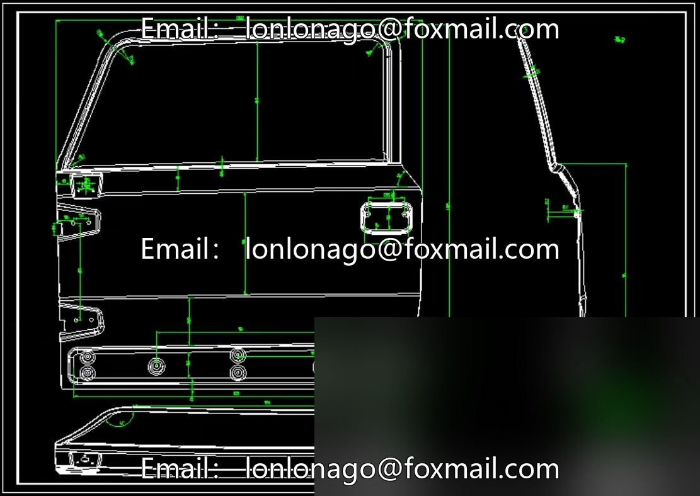
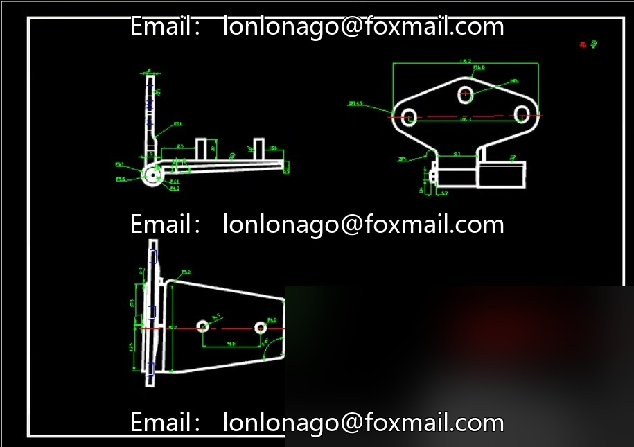
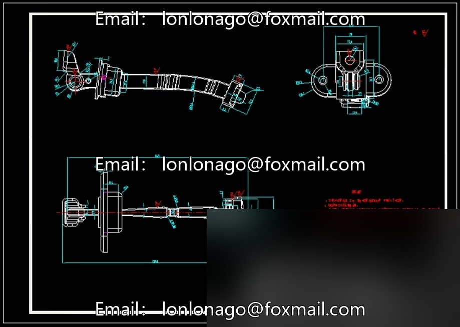
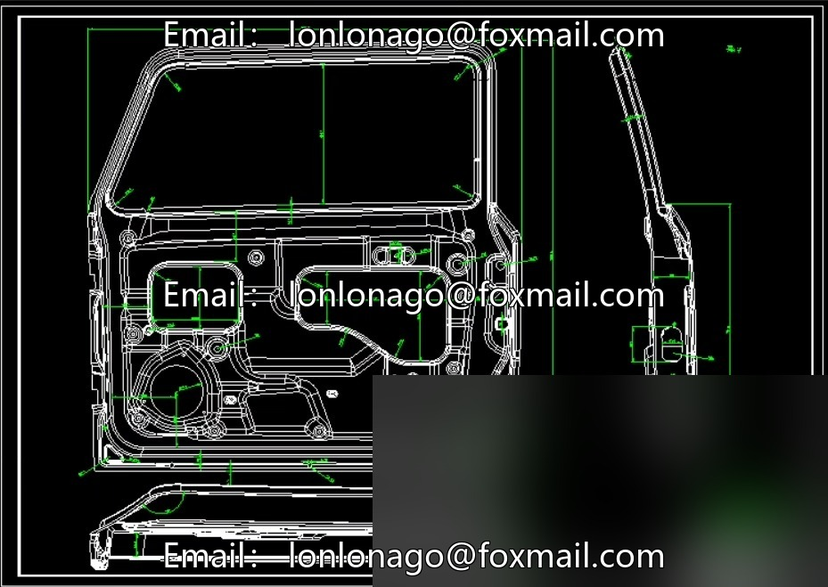
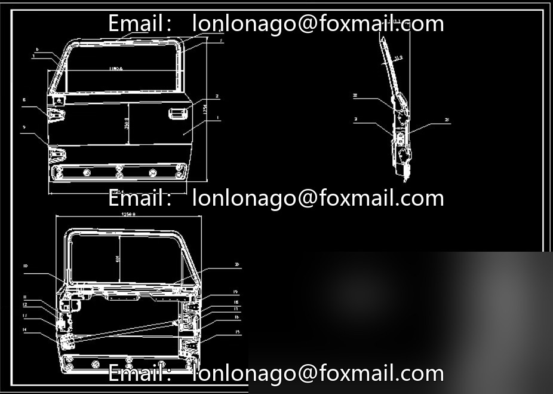
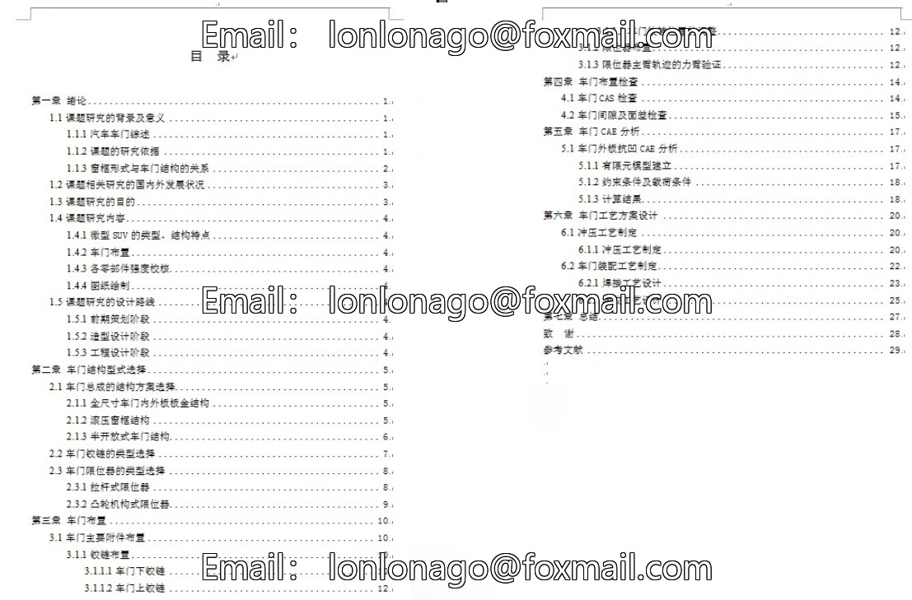

# Door design; automobile door design; door design drawing; automobile door design drawing; door design drawing

## Body

Door design; automobile door design; door design diagram; automobile door design diagram; door design CAD diagram; automobile door design CAD diagram.
This material contains CAD drawings and instructions. If needed, same-type door 3D drawings with reference will be additionally provided.
The research steps of this topic are basically divided into three steps: first, based on the characteristics of vehicle usage and structural features, the style and structure of the vehicle doors are determined. Further analyze the overall arrangement of the vehicle door based on known parameters and performance targets. Finally, according to the obtained door parameters, carry out process design and strength verification. The final designed door is a fully integrated door structure with a size of 528.

The material includes door design drawings, CAD diagrams, instructions and three-dimensional reference images, along with models, design notes and literature reviews.

<!-- AI_ENRICHED -->

## Images

## Payment

Here is a pay link on Stripe ( https://buy.stripe.com/3cs8yP7sY87d0vu9AB ). Please contact me lonlonago@foxmail.com after funding $89, and I will send you a complete data files , thank you!

